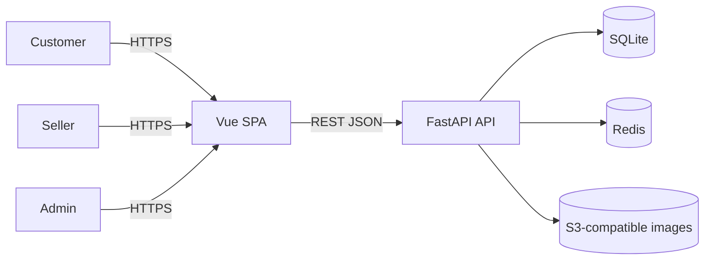
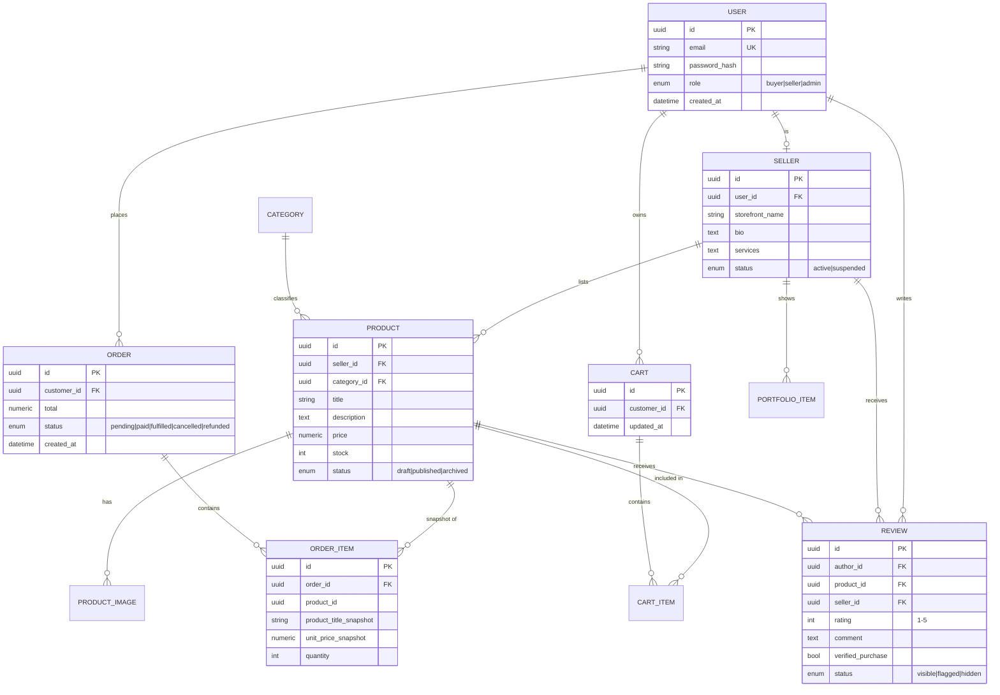

# ARCHITECTURE.md — System Architecture

> Domain vocabulary is defined in [AGENTS.md](../AGENTS.md). This document
> describes the marketplace; it deliberately contains **no** scheduling concepts
> (no time slots, availability, double-booking, or time zones).

## 1. Architectural goals

- **Clear domain boundaries:** sellers, products, carts, orders, and reviews are
  first-class concepts with explicit rules.
- **Testability:** the domain layer has no framework dependencies so business
  rules can be unit-tested first (TDD).
- **Read-heavy catalog:** fast browse/search via caching and pagination.
- **Trustworthy purchases:** orders are immutable snapshots; inventory changes
  atomically at checkout.
- **Changeability:** new marketplace features (wishlist, discounts) add modules
  without reshaping the core.

## 2. System context



## 3. Layers

```
┌──────────────────────────────────────────────────────────┐
│ Presentation (frontend/: Vue views, components, Pinia)  │
└───────────────────────────┬──────────────────────────────┘
                            │ HTTP
┌───────────────────────────▼──────────────────────────────┐
│ API layer (FastAPI routers, Pydantic schemas)            │
│ - authentication, request validation, serialization      │
└───────────────────────────┬──────────────────────────────┘
                            │
┌───────────────────────────▼──────────────────────────────┐
│ Application / service layer                              │
│ - use cases: create order, publish product, add review   │
│ - orchestration, transactions, cache invalidation        │
└───────────────────────────┬──────────────────────────────┘
                            │
┌───────────────────────────▼──────────────────────────────┐
│ Domain layer (pure business rules, entities, value obj) │
│ - Cart totals, stock rules, order snapshot, rating rules │
└───────────────────────────┬──────────────────────────────┘
                            │
┌───────────────────────────▼──────────────────────────────┐
│ Infrastructure (SQLAlchemy repos, Redis, S3 client)     │
└──────────────────────────────────────────────────────────┘
```

Dependencies point inward: the domain layer depends on nothing; infrastructure
implements interfaces declared by the application layer. See ADR-001, ADR-002.

## 4. Module map (backend)

| Module | Responsibility |
| --- | --- |
| `auth` | Registration, login, JWT issuance, role checks (buyer/seller/admin). |
| `users` | User accounts and profiles. |
| `sellers` | Storefront profile, services, portfolio items. |
| `products` | Product listings, categories, stock, images, publish state. |
| `catalog` | Browsing, filtering, search, comparison, caching. |
| `cart` | Cart lines, totals, stock validation before checkout. |
| `orders` | Checkout, order snapshots, status workflow, inventory decrement. |
| `reviews` | Product/seller ratings, comments, moderation, aggregates. |
| `admin` | Moderation and taxonomy management. |

## 5. Domain data model



Key rules:

- A `Product` belongs to exactly one `Seller`; a seller may list many products.
- An `Order` is created by a customer and contains one or more `OrderItem` rows.
- `OrderItem` stores **snapshots** of title and unit price at purchase time, so
  later product edits or price changes never rewrite history (ADR-009).
- `Cart` is mutable and transient; `Order` is immutable once committed.
- Reviews link to a product and/or seller; a `verified_purchase` flag is derived
  from order history.
- Inventory is a simple `stock` integer on `Product`; checkout decrements it
  atomically (no double-booking concept — see ADR-009).

## 6. Key flows

### 6.1 Seller publishes a product

1. Seller authenticates (JWT, role `seller`).
2. API validates the payload and ownership of the storefront.
3. Service creates `Product` in `draft` status and uploads images to object storage.
4. Seller sets `status = published`; catalog cache for that seller/category is
   invalidated.

### 6.2 Customer compares products

1. Customer filters the catalog by category/price/seller.
2. Catalog service returns paginated results (Redis cache for hot queries).
3. Frontend keeps a comparison list (max N products) in Pinia and renders a
   side-by-side table of price, specs, and seller.

### 6.3 Customer checks out

1. Cart service recomputes totals from **current** product prices and validates stock.
2. Checkout transaction: for each line, decrement `stock` conditionally
   (`stock >= quantity`) and insert `OrderItem` snapshots.
3. If any line fails validation, the transaction rolls back and the cart is left
   untouched; the customer sees an out-of-stock error.
4. On success, create `Order`, clear the cart, and return the order detail.

### 6.4 Customer leaves a review

1. API checks the customer purchased the product (`verified_purchase`).
2. Service persists rating (1–5) and comment, then recomputes the aggregate rating
   cached on the product/seller.
3. Flagged reviews enter moderation before becoming visible.

## 7. API conventions

- REST over HTTPS, JSON bodies, versioned under `/api/v1`.
- Resource-oriented paths: `/sellers/{id}`, `/products`, `/cart/items`, `/orders`,
  `/reviews`.
- Standard status codes: 200/201 success, 400 validation, 401 unauthenticated,
  403 forbidden, 404 not found, 409 conflict (e.g., insufficient stock), 422
  schema errors.
- Pagination via `page`/`page_size`; filtering via query parameters.
- Idempotency keys for checkout to avoid duplicate orders on retry.

## 8. Cross-cutting concerns

| Concern | Approach |
| --- | --- |
| Auth | JWT access tokens; roles buyer/seller/admin; ownership checks in services. |
| Validation | Pydantic schemas at the boundary; domain rules in the domain layer. |
| Errors | Consistent error envelope with code, message, and request ID. |
| Caching | Redis for hot catalog/search responses; explicit invalidation on writes. |
| Images | S3-compatible storage; signed URLs for uploads; CDN-friendly keys. |
| Observability | Structured logs, request IDs, health/readiness endpoints. |
| Localization | Currency formatting handled in frontend; prices stored as decimals. |

## 9. Non-functional targets

- p95 catalog response < 200 ms for cached queries.
- Checkout is atomic; no order is created without corresponding stock decrement.
- API replicas scale horizontally; SQLite is the MVP source of truth, with a repository boundary for the later PostgreSQL migration (ADR-0010).
- Accessibility: WCAG 2.1 AA on customer-facing flows (see SRS).

## 10. Decisions index

See [docs/adr/README.md](./adr/README.md) for all architecture decisions, including
stack choices, storage, caching, authentication, and order-snapshot semantics.
